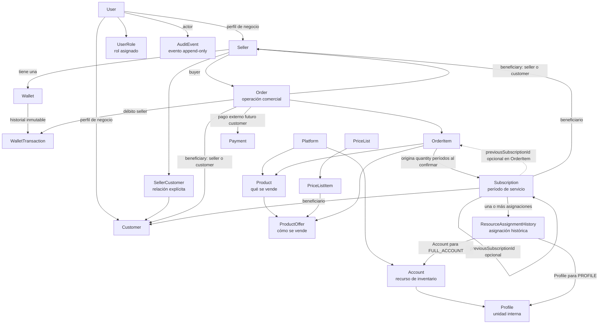
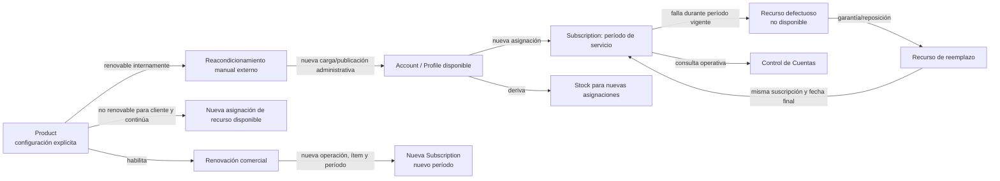

# Mapa del Dominio

Este mapa expresa relaciones conceptuales del dominio; no es un diseño de tablas ni de clases. La disponibilidad de stock se deriva de los recursos de inventario elegibles para nuevas asignaciones.

## Vista general

## Stock y control de cuentas

* Una nueva asignación consume disponibilidad derivada de [[Account]] o [[Profile]].
* Product configura de forma independiente si el cliente puede renovar y si el negocio puede reacondicionar/reutilizar internamente el recurso.
* Una renovación/continuidad conserva `previousSubscriptionId` en OrderItem durante el borrador y lo copia a Subscription al confirmar. Solo se confirma al alcanzar el vencimiento previo; si conserva recurso, RAH anterior se libera y la nueva asignación se crea atómicamente sin consumir stock.
* Una garantía o reposición por fallo asigna otro recurso y no se considera una renovación.
* La garantía mantiene el período, vencimiento y días restantes de la misma [[Subscription]]; no genera una nueva compra ni cobro.
* El estado ACTIVE/EXPIRED de Subscription se deriva de las fechas, no se persiste. El estado ACTIVE/EXPIRED de Subscription se deriva de las fechas, no se persiste. El vencimiento no devuelve automáticamente un recurso al inventario. El reacondicionamiento ocurre fuera de la plataforma y el recurso solo vuelve con una nueva carga/publicación administrativa.
* El recurso retenido actual es la asignación más reciente sin `releasedAt`; [[ResourceAssignmentHistory]] conserva la asignación inicial, actor/motivo de liberación y reemplazos por garantía.
* “Control de Cuentas” es una funcionalidad de consulta sobre inventario, órdenes y suscripciones, no una entidad definida.

## Reglas de lectura

* ADMIN se representa como `User + Role(ADMIN)`; no existe una entidad `Admin`.
* `SellerCustomer` es la relación explícita N:N entre [[Seller]] y [[Customer]], no un `sellerId` único en Customer.
* [[Product]] es qué se vende y pertenece a una [[Platform]]; [[ProductOffer]] es cómo se vende; [[Account]] y [[Profile]] son recursos de inventario. La trazabilidad hacia Subscription pasa por ProductOffer y OrderItem; Product no se relaciona directamente con Subscription.
* [[Account]] y [[Profile]] persisten `isActive`; vistas derivan disponibilidad, incluida `BLOCKED_BY_FULL_ACCOUNT`. `EXPIRED` pertenece exclusivamente a [[Subscription]].
* [[Order]] es la operación comercial y contiene cero o más [[OrderItem]] mientras está `PENDING`; para confirmar debe contener uno o más. Cada ítem conserva el snapshot comercial específico; los recursos operativos no pertenecen a ese snapshot.
* [[Subscription]] representa un período de servicio del beneficiario; cada período confirmado tiene una asignación inicial obligatoria y puede tener reemplazos en [[ResourceAssignmentHistory]].
* `PROFILE` asigna un perfil; `FULL_ACCOUNT` asigna una cuenta completa, la deja `FULLY_ASSIGNED` y hace que sus perfiles no estén disponibles para nuevas ventas como condición derivada, sin crear `BLOCKED` como estado de Profile.
* La renovabilidad pertenece a [[Product]], no a la cuenta o perfil concreto.
* Una garantía puede reemplazar una cuenta completa por otra cuenta o un perfil por otro perfil de la misma u otra cuenta; el recurso defectuoso queda no disponible.
* [[Order]] conserva datos comerciales históricos inmutables; los datos operativos del recurso pueden cambiar sin modificar el pedido.
* Una compra de Seller bloquea su [[Wallet]] y su [[Order]]: solo la Wallet del buyer puede financiarla y existe como máximo un `PURCHASE_DEBIT` por orden. El precio se determina al confirmar y queda como snapshot.
* [[Seller]] y [[Wallet]] nacen juntos en una única transacción; toda Wallet inicia con saldo cero y no requiere una recarga ficticia.
* `saleMode` de [[ProductOffer]] es la fuente comercial de verdad: el snapshot de [[OrderItem]] y la forma de [[ResourceAssignmentHistory]] deben conservar `PROFILE → Profile` o `FULL_ACCOUNT → Account`, incluso ante garantía.
* Toda [[Account]] se confirma con al menos un [[Profile]] asociado; credenciales incompletas no habilitan una excepción a ese mínimo.
* [[WalletTransaction]] usa una secuencia contable creciente por [[Wallet]]; el timestamp no determina el orden del saldo.
* El estado de reverso mostrado por CU-008 se deriva de que exista una fila `REVERSAL`; WalletTransaction no tiene estado persistido.
* [[AuditEvent]] guarda actor, acción, objeto, hora y contexto no secreto. Cada lectura de credenciales queda auditada; no se guardan secretos en el evento.
* Tras la primera asignación histórica, Platform de [[Account]] y Account de [[Profile]] no cambian; esto preserva el significado de [[ResourceAssignmentHistory]].
* Platform, Product, ProductOffer, PriceList, User, Seller, Customer y SellerCustomer usan `ACTIVE`/`INACTIVE`. La inactivación bloquea nuevas operaciones dependientes, sin cascadas automáticas ni alteración del historial o Subscription vigentes.
* La elegibilidad de una nueva compra se calcula de forma compuesta: actores y relación comercial activos, catálogo y precio vigentes, inventario elegible, saldo suficiente y moneda compatible.

## Enlaces

[[User]] · [[Seller]] · [[Customer]] · [[AuditEvent]] · [[Platform]] · [[Account]] · [[Profile]] · [[Product]] · [[ProductOffer]] · [[PriceList]] · [[PriceListItem]] · [[Wallet]] · [[WalletTransaction]] · [[Order]] · [[OrderItem]] · [[Subscription]] · [[ResourceAssignmentHistory]] · [[Payment]]
