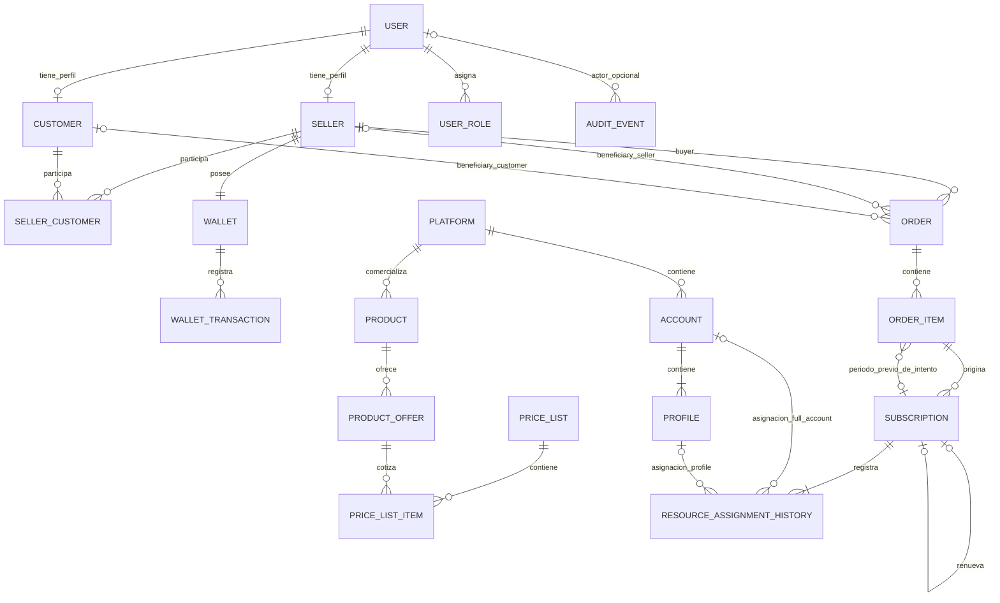

# Modelo ER — Base conceptual

Este modelo representa relaciones conceptuales; no define tablas, SQL, tipos, claves ni restricciones físicas.

## Reglas que complementan el diagrama

* Los tres y únicos roles son `ADMIN`, `SELLER` y `CUSTOMER`. ADMIN es un User con ese rol, no una entidad independiente.
* `UserRole` conserva los roles asignados; los códigos son cerrados y no existe tabla Role dinámica. `AuditEvent` registra actor, operación, objeto polimórfico, hora y contexto seguro; no almacena secretos.
* Cada Order tiene exactamente un beneficiary: el Seller buyer o un Customer relacionado mediante `SellerCustomer`; las dos relaciones de beneficiary son excluyentes.
* Una Order `PENDING` puede tener temporalmente cero OrderItems; para confirmar debe tener uno o más. Toda Order `CONFIRMED` tiene al menos un OrderItem y cada OrderItem pertenece a exactamente una Order.
* Cuando el beneficiary es Seller, existe una referencia explícita a Seller y debe ser el mismo Seller buyer. Cuando es Customer, existe Customer y su relación con el buyer mediante SellerCustomer.
* La relación SellerCustomer debe estar activa al crear una Order para Customer; su posterior inactivación no reescribe el histórico. No se crea automáticamente como efecto de una venta.
* Cada ResourceAssignmentHistory referencia exactamente una Account o un Profile según la modalidad; las dos relaciones de recurso son excluyentes. El recurso actual es la asignación vigente más reciente.
* Toda Subscription existente al COMMIT tiene exactamente una asignación inicial `INITIAL_ASSIGNMENT` y puede tener reemplazos `WARRANTY_REPLACEMENT`; una sustitución no reemplaza la asignación inicial obligatoria.
* Account → Profile es `1 : 1..N`. Un Profile tiene como máximo una asignación vigente; una Account tiene como máximo una asignación `FULL_ACCOUNT` vigente y puede tener `0..N` asignaciones `PROFILE` vigentes mediante Profiles distintos. No existe una cardinalidad global `Account → ResourceAssignmentHistory = 1 : 0..1`.
* Una asignación `FULL_ACCOUNT` vigente excluye cualquier otra asignación vigente de esa Account. Una misma Account puede, en cambio, tener varios Profiles asignados simultáneamente.
* OrderItem contiene snapshots comerciales; Account y Profile son recursos operativos registrados solo a través de ResourceAssignmentHistory.
* Una Order usa una única moneda y sus OrderItem conservan esa moneda. En una compra por Wallet también coincide con Wallet y WalletTransaction.
* Una compra por Wallet solo puede usar la Wallet del Seller buyer y produce, como máximo, un `PURCHASE_DEBIT` por Order. El saldo y el historial se serializan por Wallet.
* WalletTransaction tiene una secuencia contable monotónica por Wallet; su último número determina el saldo histórico vigente, no el timestamp del evento.
* Seller → Wallet es `1 : 1`: el alta atómica de Seller crea su Wallet con saldo cero. No se confirma un Seller sin Wallet ni se permite mover o eliminar su Wallet obligatoria.
* ProductOffer pertenece obligatoriamente al Product registrado por OrderItem. Un Product puede tener, como máximo, una ProductOffer activa por cada modalidad.
* `ProductOffer.saleMode` es la fuente comercial de verdad. OrderItem conserva ese valor como snapshot al crearse y cada ResourceAssignmentHistory debe usar Profile para `PROFILE` o Account para `FULL_ACCOUNT`, incluso en un reemplazo de garantía. Desde la primera línea, la modalidad de la oferta es inmutable.
* Para cada rol objetivo existe como máximo una PriceList activa. PriceListItem usa intervalos semiabiertos y no admite solapamiento de igual prioridad para la misma lista y oferta.
* Product configura renovabilidad, pero no posee relación directa con Subscription. La trazabilidad comercial es `Product → ProductOffer → OrderItem → Subscription`.
* Todo Product pertenece a una Platform. La asignación exige que la Platform del recurso coincida con la Platform del Product de la ProductOffer vendida.
* Una renovación/continuidad conserva `previous_subscription_id` en OrderItem aun mientras la Order es PENDING; la Subscription confirmada copia el vínculo y cada período tiene como máximo un sucesor confirmado. La relación de OrderItem representa intención reintentable; la autorreferencia de Subscription representa linaje realizado. No existe `Renewal` ni `RenewalHistory`.
* Garantía, reemplazo, reacondicionamiento, stock, buyer, beneficiary y Control de Cuentas no son entidades independientes. Stock y recurso actual son derivados; Control de Cuentas es una consulta operacional.
* [[Payment]] corresponde a compras directas futuras de Customer. Su relación y cardinalidad con Order permanecen fuera del modelo cerrado hasta definir esa política.

## Alcance conceptual

* Account/Profile persisten `isActive`; los códigos de disponibilidad se derivan mediante vistas desde la habilitación, credenciales y asignaciones vigentes. `EXPIRED` pertenece solo a Subscription.
* Para `FULL_ACCOUNT`, la Account queda `FULLY_ASSIGNED`; sus Profiles derivan disponibilidad `BLOCKED_BY_FULL_ACCOUNT`. Ninguno de esos estados se persiste.
* El vencimiento no devuelve recursos al inventario. El reingreso requiere reacondicionamiento manual externo y carga/publicación administrativa posterior.
* Los datos comerciales históricos de Order/OrderItem y WalletTransaction son inmutables. ResourceAssignmentHistory es append-only, salvo completar una sola vez fecha, actor y motivo de liberación. Los datos de Account, Profile y el recurso actual son operativos y pueden cambiar sin alterar la venta.
* Toda Account confirmada requiere uno o más Profiles asociados; las credenciales de streaming pueden cargarse después de crearla, pero mientras falten o no sean válidas tampoco es elegible. La incompletitud administrativa solo admite credenciales pendientes, no ausencia de Profiles, y no añade estados nuevos.
* Las mutaciones de inventario se ejecutan mediante una frontera PostgreSQL autorizada: toma las Accounts raíz antes de Profiles, historial y Subscriptions afectados. No existe DML directo del rol de aplicación sobre esas tablas.
* La Platform de una Account y la Account propietaria de un Profile no pueden cambiar después de su primer uso en asignaciones históricas; el recurso operativo puede cambiar en otros atributos sin reinterpretar el historial.
* Platform, Product, ProductOffer, PriceList, User, Seller, Customer y SellerCustomer usan `ACTIVE`/`INACTIVE`; la inactivación bloquea elegibilidad futura sin cascadas automáticas ni cambios históricos. Account/Profile guardan solo `isActive` y no materializan un segundo estado de disponibilidad.

Las decisiones físicas del MVP están definidas en [[Modelo-Fisico-PostgreSQL]].
